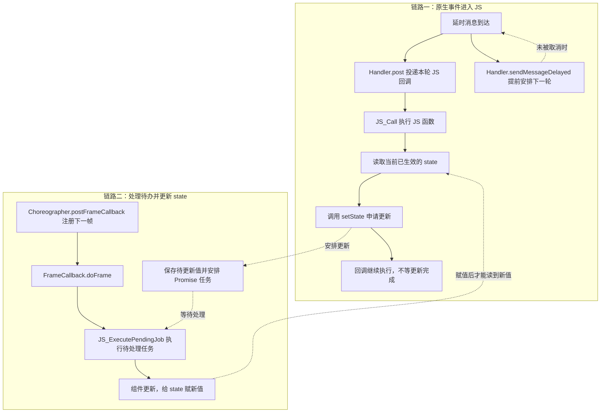

# 跨端框架中的异步回调与 state 更新机制

**异步回调执行了，不代表它申请的 `state` 更新已经生效；`state` 生效了，也不代表界面已经画出来。** 在嵌入式 JS 跨端框架里，原生宿主负责把事件交给 JS 引擎，组件框架则负责调度状态更新。即使两条链路最终在同一个线程上执行，它们也不一定由同一个入口驱动。

## 先看一个例子：回调跑了，为什么还读到旧值？

假设一个页面从 3 秒开始倒计时，归零时通知服务端。下面用普通 JavaScript 模拟「更新已提交申请，但尚未生效」：测试里手动调用 `tick()` 代表定时器运行一轮，`applyState()` 代表状态更新生效，`sendRequest()` 只打印，不会实际联网。

```js
let state = { remaining: 3 };
let pendingRemaining = state.remaining;

function sendRequest() {
  console.log('发起到期请求');
}

function tick() {
  const next = state.remaining - 1;
  pendingRemaining = next;
  console.log(`读到 ${state.remaining}，申请更新为 ${next}`);
  if (next === 0) sendRequest();
}

function applyState() {
  state = { remaining: pendingRemaining };
}

tick(); // 读到 3，申请更新为 2
tick(); // 还是读到 3，又申请更新为 2
tick(); // 第三轮依然如此，没有发请求

applyState(); // 现在才读得到 2
tick();       // 读到 2，申请更新为 1
applyState();
tick();       // 读到 1，算出 0，这时才发请求
```

这里不是在模拟某个框架怎么调度，而是在说明：**哪怕定时器连续执行了三轮，只要每轮都从旧值开始算，就不等于倒计时走了三秒。**

这个例子对应一种实际观察：定时器每轮读到 15，再算出 14，却一直读不到更新后的 14。归零判断依赖旧 `state`，因此卡住期间根本没有进入发请求的分支。问题不在请求，而在于**下一轮计算依赖上一轮状态已生效**。

## 两条链路：调用 JS 与让 state 生效

以下用一种 Android 宿主实现说明，不代表所有跨端框架都按帧处理 JS 待办。

1. **JS 回调怎么进来。** 原生定时器的延时消息到达后，宿主把回调投递到 JS 所在线程，再调用引擎接口执行这个函数。这只证明本轮回调执行了；在这条实现路径上，函数返回时不会顺带处理 `Promise` 待办。
2. **`state` 怎么生效。** 对照的类组件实现中，`setState` 先把新值合并到待更新状态，再通过 `Promise` 安排后续更新。宿主在帧回调中驱动引擎处理待办，直到组件更新执行到赋值，`this.state` 才读得到新值。多次申请写入同一个值，可以合并成一次更新，并不代表组件会把所有中间值逐个补出来。
3. **这和绘制是两码事。** 帧回调在这里负责启动任务处理，不代表 `state` 要等原生界面画完才会变。定位问题时，要区分「JS 回调执行」「状态赋值」和「界面绘制」三个时点。

### 具体用到了哪些原生 API

| 环节 | API | 在这条链路里做什么 |
| --- | --- | --- |
| 页面可见性 | `Activity.onStop()` / `Activity.onResume()` | `onStop()` 通知页面不可见，`onResume()` 通知页面恢复交互。对照的实现没有在不可见回调中直接取消定时器；页面不可见和组件卸载是两件事。 |
| 定时器调度 | `Handler.sendMessageDelayed(Message, long)` → `Handler.post(Runnable)` | 前者安排下一轮延时消息，后者把本轮 JS 回调投递到对应线程。进入消息队列不等于准点执行。 |
| 执行 JS 回调 | `JS_Call(ctx, func, thisArg, argc, argv)` | 调用这一轮的 JS 函数；对照的这条调用路径没有顺带处理 `Promise` 待办队列。 |
| 注册和接收帧 | `Choreographer.getInstance().postFrameCallback(callback)` → `Choreographer.FrameCallback.doFrame(long)` | 注册下一帧的单次回调；要继续接收，需再次注册。对照实现从帧回调启动待办任务处理：符合线程条件时直接执行，否则用 `Handler.post(Runnable)` 投递。销毁引擎时使用 `removeFrameCallback(callback)` 移除回调。 |
| 处理 JS 待办 | `JS_IsJobPending(runtime)` → `JS_ExecutePendingJob(runtime, &ctx)` | 前者检查运行时是否有待办，后者一次执行一个待办。真正执行到对应的组件更新，`this.state` 才变成新值；进了原生入口不等于已经处理了这次更新。 |

`Activity`、`Handler` 和 `Choreographer` 是 Android API；`JS_Call` 等是公开的 JavaScript 引擎 C API。**用帧回调来处理待办是这里的宿主实现选择，不是 Android 或 JavaScript 规定 `setState` 必须等一帧。**



## 页面生命周期为什么会放大这个问题？

页面不可见、组件卸载和 JS 运行时销毁不是同一件事。在对照实现中，`onStop()` 不会直接清除组件定时器。一次熄屏样本里，延时消息仍能把计时回调送进 JS，但用于驱动待办处理的应用帧回调一度没有出现在采集记录中。两条路径因此可能一条还在跑，另一条没及时处理。这个样本不能证明所有后台场景都会如此，也不能仅凭系统帧日志确定具体卡在宿主的哪一层。

**设计上的启示：** 如果一个动作必须按截止时间触发，不要从用于展示的 `state` 反推它该不该执行。用截止时间判断到期，`state` 只用于展示；如果后台期间宿主没有调度回调，恢复时可以补算，但不能承诺后台准点执行。
